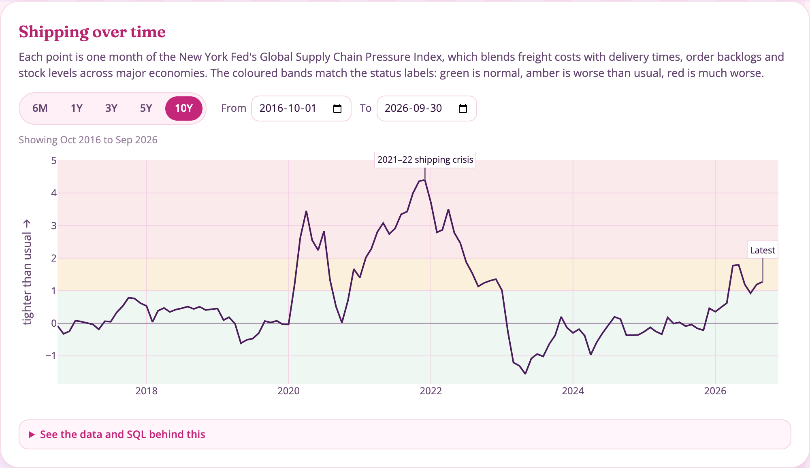

<p align="center">
  
</p>

<p align="center">
  <a href="https://mallika-madhok.github.io/supplychain-healthcheck/"></a>
  
  
</p>

## So, what is this?

For small businesses importing clothing and shoes into Canada, the costs that matter most are the ones they don't control. Larger retailers have analysts watching them. A small importer usually finds out after the fact, when a shipment is already late or an invoice is already higher, and by then it is too late to prepare.

This app gives you a heads-up. You enter a few details about your business, and it gives you a monthly **pressure reading** on three signals:

 &nbsp;**Shipping:** whether shipping rates, supplier delivery times and order backlogs around the world are running higher than normal.

 &nbsp;**Currency:** how far the US dollar has moved against the Canadian dollar, and how unpredictable it has been. Most clothing is invoiced in US dollars, so when the Canadian dollar weakens your bill goes up even if your supplier's price hasn't changed.

 &nbsp;**Suppliers:** how much of your stock depends on a handful of countries. The more it does, the harder a single tariff change, port strike or factory shutdown hits you.

Each signal gets a status and a short note on what is worth checking in your own business, so you can look into it early and be better prepared.

<p align="center">
  
  
  
</p>

### How it works, in short

⭐ Each signal comes from free public data: the New York Fed, the Bank of Canada and Statistics Canada. It refreshes every week.

⭐ Today's value is compared with that signal's own history and turned into a **z-score**: how far today sits from its average, measured in standard deviations.

⭐ The z-score sets the status: below 1 is **Normal**, 1 to 2 is **Worse than usual**, above 2 is **Much worse than usual**.

⭐ The currency reading is also turned into dollars for your purchases, so you can see what a move in the exchange rate means for your bill.

<p align="center">
  
</p>

<p align="center"></p>

## How do I use it?

1. Pick what you mostly buy, like T-shirts, jeans or leather shoes.
2. Enter your monthly purchases and the share paid in US dollars.
3. Add the countries your goods come from and set roughly how much comes from each.

Everything updates as you go. Not sure where to start? There are starting points for "what Canada as a whole imports", "one country does most of it" and "spread across many". Each chart also has quick time windows (like 6M, 1Y or 5Y) suited to how often that data updates, plus a date range if you want something specific.

## What the reading points you to

| When the app flags | What is worth checking |
|---|---|
| Shipping is worse than usual | Your orders due to ship in the next few months, especially anything tied to a launch or sale date |
| The exchange rate is moving against you | What your upcoming US dollar invoices will cost at today's rate (shown in dollars for your purchases), and whether your prices still cover it |
| Too much of your buying comes from one country | How you would cope if supply from that country were disrupted, plus which other countries Canada already buys that product from |

The app doesn't tell you what to do. It can't know your contracts, margins or suppliers, and you do. It tells you, early and in plain terms, when something is worth a closer look. When all three are normal, nothing needs your attention.

<p align="center"></p>

## The details

### What a z-score means

A standard deviation is the size of a typical swing for a signal. Measuring every signal in standard deviations makes it a fair ruler for very different things, like a freight index and an exchange rate.

⭐ **Around 0:** right at the average.

⭐ **Up to 1:** within a normal range.

⭐ **1 to 2:** unusual. It happens, but not often.

⭐ **2 to 3:** rare.

⭐ **3 or more:** something is really off.

### How each signal is measured

| Signal | What is measured | Source |
|---|---|---|
|  Shipping | The Global Supply Chain Pressure Index, which combines shipping rates with supplier delivery times, order backlogs and stock levels across major economies. It is judged against its full history since 1998, because a shorter baseline would be dominated by the 2021–22 crisis and make bad conditions look normal. | New York Fed |
|  Currency | How far the US/Canadian dollar rate moved over the last 30 trading days (about six weeks), and how much it has moved day to day over the last 90, both compared with history since 2017. The dollar figures are simple arithmetic: monthly purchases × USD share × the change in the rate. | Bank of Canada |
|  Suppliers | How much your buying relies on one country, as a reliance score: square each country's share and add them up (one country at 100% gives 1, an even spread gives close to 0). Compared with how much other clothing and footwear imports into Canada rely on one country. | Statistics Canada import records, by product and country |

<p align="center">
  
</p>

### Nothing is a black box

Every section of the app has a "See the data and SQL behind this" box. Open it to see the data table behind the chart and the exact query used to calculate it.

### How it stays up to date

Once a week, an automated job downloads the latest data, cleans it, recalculates everything and refreshes the site. There is no server, no login, and nothing you enter ever leaves your browser. It all runs on free services.

<p align="center"></p>

## For the technically curious

1. **Python** downloads the raw data from the New York Fed, the Bank of Canada and Statistics Canada.
2. **dbt**, running on **MotherDuck** (a free cloud database), cleans and reshapes it, with data quality tests at each step.
3. The results are saved as small **Parquet** files in this repo.
4. The site, hosted on **GitHub Pages**, loads those files and runs the calculations in your browser with **DuckDB-Wasm**.
5. **GitHub Actions** runs steps 1 to 3 every Monday.

| Folder | What is in it |
|---|---|
| `src/pipeline/` | Python code that downloads and loads the data |
| `dbt/` | The cleaning and calculation steps, with data quality tests |
| `data/` | The finished data files |
| `docs/` | The website |
| `.github/workflows/` | The weekly update job |
| `tests/` | Tests for the Python code |

To run it yourself:

```bash
uv sync
uv run pytest

# Run the pipeline (needs a MotherDuck token saved as MOTHERDUCK_TOKEN in .env)
set -a && source .env && set +a
uv run python -m pipeline.extract
uv run python -m pipeline.extract_cimt
uv run python -m pipeline.load_motherduck
uv run dbt build --project-dir dbt --profiles-dir dbt/profiles
uv run python -m pipeline.export_marts

# View the website
cd docs && python3 -m http.server 8000
```

## Limits to keep in mind

⭐ Your inputs are a rough picture of your buying, not your actual orders.

⭐ The dollar figures assume you keep buying the same amount and pay today's exchange rate. If you have locked in a rate with your bank, or your supplier changes its prices when the rate moves, your real numbers will differ.

⭐ History shows what is unusual. It is not a forecast, and this is not financial advice.

⭐ Country means where customs says the goods were made, which is not always where they were sewn.

⭐ The cut-offs for Worse than usual and Much worse than usual are a first-pass choice and haven't been tested against real price changes yet.

<p align="center"></p>

<p align="center"><sub>Concept and methodology by <b>Mallika Madhok</b> · Data from the New York Fed, Bank of Canada and Statistics Canada</sub></p>
