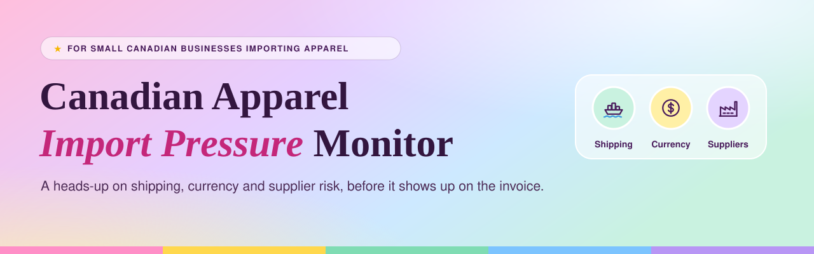
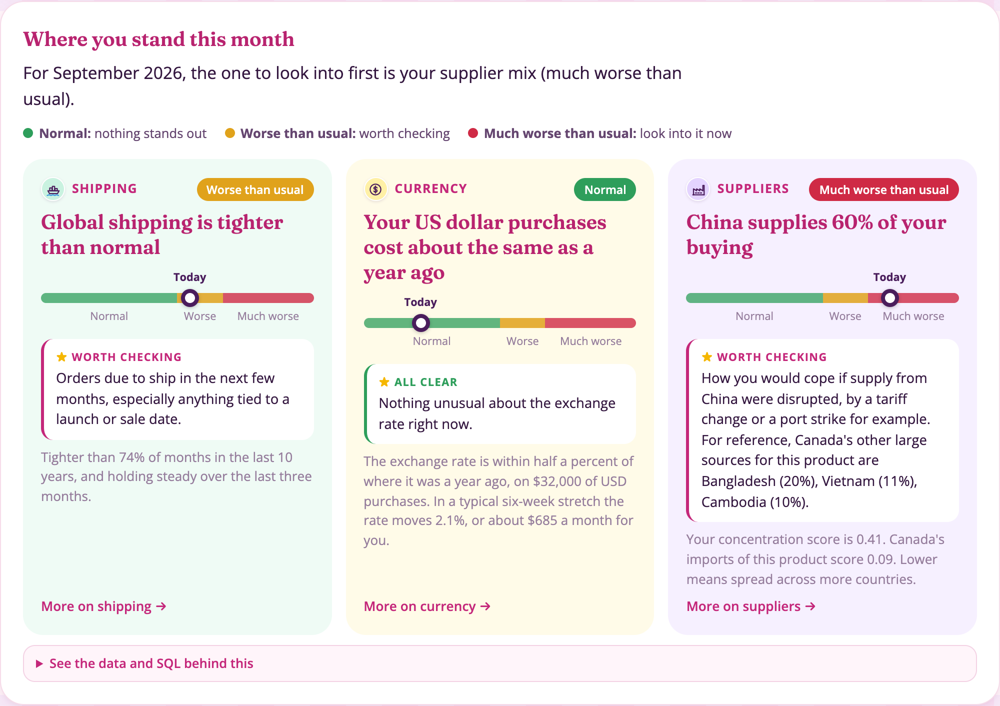

<p align="center">
  
</p>

<p align="center">
  <a href="https://mallika-madhok.github.io/supplychain-healthcheck/"></a>
  
  
</p>

## So, what is this?

Small Canadian businesses that import apparel usually find out costs have gone up too late, when a shipment arrives late or an invoice comes in higher. This app gives them a heads-up.

You enter what you buy, how much you spend and where it comes from. The app gives you a monthly pressure reading on three signals:

 &nbsp;**Shipping:** are shipping costs and delivery times higher than normal?

 &nbsp;**Currency:** how much has the US dollar moved against the Canadian dollar? Most clothing is paid for in US dollars, so this changes your bill.

 &nbsp;**Suppliers:** how much of your stock comes from one country? The more it does, the harder a single problem there, like a new tariff, hits you.

Each signal comes with a short note on what to check, like orders due to ship soon.

### How the reading works

Each signal is compared with its own history using a **z-score**: how far today is from the average, measured in standard deviations (the size of a normal up-and-down for that signal).

⭐ Below 1: **Normal**

⭐ 1 to 2: **Worse than usual**

⭐ Above 2: **Much worse than usual**

The data comes from the New York Fed, the Bank of Canada and Statistics Canada, and updates every week.

<p align="center">
  
</p>

<p align="center"></p>

## How do I use it?

1. Pick what you mostly buy.
2. Enter your monthly purchases and how much of it you pay in US dollars.
3. Add the countries you buy from.

Results update as you type.

## The details

| Signal | What is measured | Source |
|---|---|---|
|  Shipping | The Global Supply Chain Pressure Index, compared with its full history since 1998 | New York Fed |
|  Currency | How much the US/Canadian dollar rate changed over the last six weeks, and how much it went up and down over the last four months, compared with history since 2017 | Bank of Canada |
|  Suppliers | A reliance score from 0 (spread across many countries) to 1 (all from one), compared with other clothing and footwear imports into Canada | Statistics Canada |

Every chart has a "See the data and SQL behind this" box showing the exact data and query behind it.

<p align="center"></p>

## For the technically curious

Every Monday, GitHub Actions runs **Python** to download the data, then **dbt** on **MotherDuck** to clean it and calculate the signals. The results are saved as **Parquet** files, which the site on **GitHub Pages** reads with **DuckDB-Wasm**, so everything runs in your browser and nothing you enter leaves it.

| Folder | What is in it |
|---|---|
| `src/pipeline/` | Python code that downloads and loads the data |
| `dbt/` | The cleaning and calculation steps, with data tests |
| `data/` | The finished data files |
| `docs/` | The website |
| `.github/workflows/` | The weekly update job |
| `tests/` | Tests for the Python code |

To run it yourself:

```bash
uv sync
uv run pytest

# Run the pipeline (needs MOTHERDUCK_TOKEN in .env)
set -a && source .env && set +a
uv run python -m pipeline.extract
uv run python -m pipeline.extract_cimt
uv run python -m pipeline.load_motherduck
uv run dbt build --project-dir dbt --profiles-dir dbt/profiles
uv run python -m pipeline.export_marts

# View the website
cd docs && python3 -m http.server 8000
```

## Limits

⭐ It shows what is unusual, not what will happen. It isn't financial advice.

⭐ Dollar figures assume you keep buying the same amount at today's exchange rate.

⭐ The cut-offs between Normal, Worse than usual and Much worse than usual haven't been tested against real price changes yet.

<p align="center"></p>

<p align="center"><sub>Concept and methodology by <b>Mallika Madhok</b> · Data from the New York Fed, Bank of Canada and Statistics Canada</sub></p>
